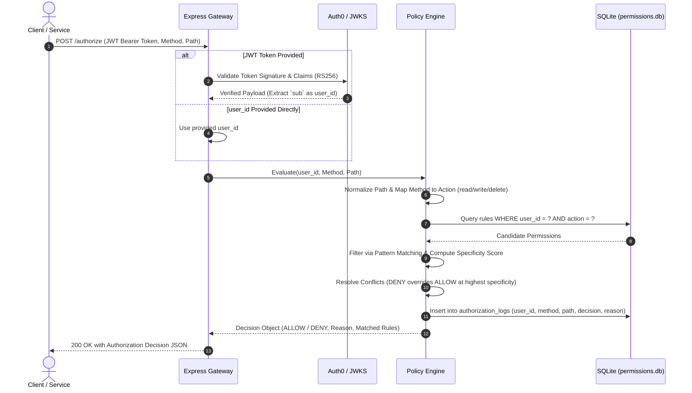
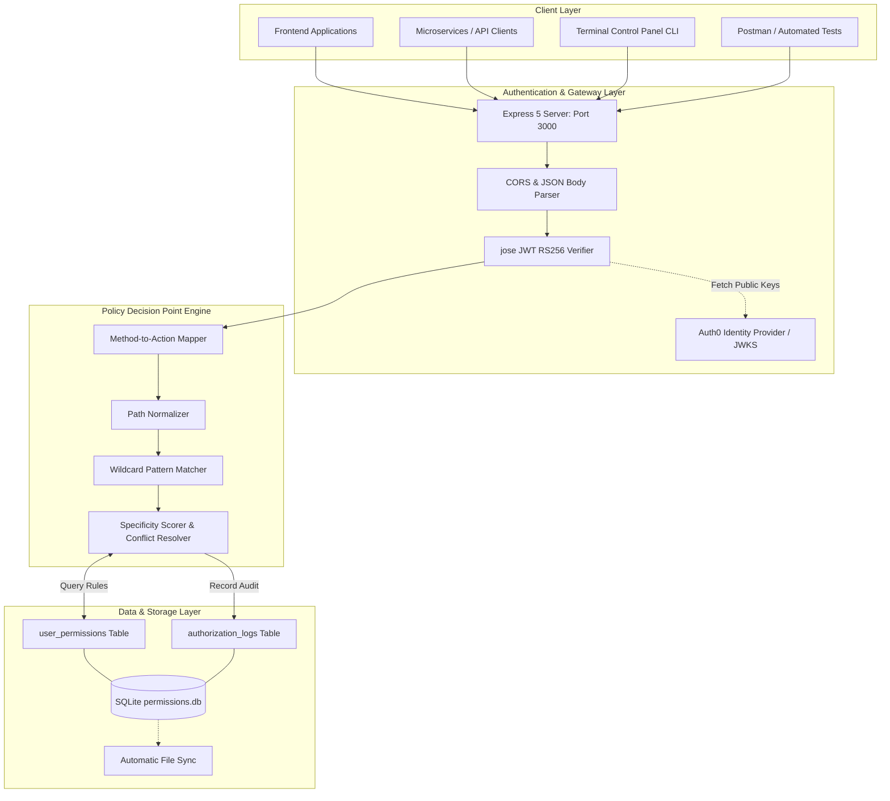

# 🛡️ Auth & Authorization Service

A high-performance Authentication & Dynamic Authorization microservice featuring Auth0 JWT verification (RS256), fine-grained SQLite policy enforcement with hierarchical wildcard matching, audit decision logging, and a rich Terminal Control Panel (CLI).

---

## 📌 Problem Statement

In distributed systems and microservice architectures, access control is frequently compromised by fundamental structural limitations:

1. **Decoupled Auth & Monolithic Role Models**: Applications commonly conflate authentication ("Who is calling?") with authorization ("What can they do?"). Hardcoded Role-Based Access Control (RBAC) inside individual services creates rigid silos that cannot adapt to fine-grained access requirements.
2. **Lack of Dynamic Policy Management**: Changing a user's permissions often requires modifying code, redeploying services, or updating rigid database schemas across multiple applications.
3. **Complex Resource Hierarchy Challenges**: Traditional authorizers fail to cleanly express permissions across nested collections, wildcards (e.g., `wallets/*` vs. `wallets/wallet-123/transactions`), and specific resource instances.
4. **Conflict Resolution Ambiguity**: Without deterministic policy evaluation (such as rule specificity scoring and explicit deny overrides), access decisions become unpredictable and vulnerable to privilege escalation.
5. **Absence of Centralized Decision Auditing**: Security compliance demands full audit trails for every access evaluation with exact rationale and timestamps.

---

## 💡 Solution

This service delivers an enterprise-grade **Policy Decision Point (PDP)** and **Authentication Gateway**:

- **Auth0 JWT (RS256) Verification**: Validates caller identity using remote JSON Web Key Sets (JWKS) and extracts identity claims (`sub`).
- **Dynamic Policy Engine**: Stores fine-grained rules in an embedded, ultra-fast SQLite engine (`better-sqlite3`), mapping `user_id`, `action`, `resource`, and `effect` (`allow` / `deny`).
- **Hierarchical Wildcard Matching & Specificity Scoring**: Evaluates resource patterns using single-segment wildcards (`*`) and collection inheritance, resolving conflicts deterministically where explicit `deny` overrides `allow` at the highest specificity level.
- **Persistent Decision Audit Logs**: Every authorization check is automatically persisted with decision results, user identity, target path, HTTP method, and detailed reasoning.
- **Dual-Mode Operation**: Fully accessible via standard REST API endpoints or an interactive Terminal Control Panel (CLI) requiring zero web frontend overhead.

---

## 🔄 Workflow



### Detailed Workflow Steps

1. **Request Ingestion**: The client submits a request to `POST /authorize` containing either an Auth0 JWT (`access_token` or `Authorization: Bearer <token>`) or a direct `user_id`, alongside the target `method` and `path`.
2. **Identity Verification**: If a JWT is supplied, `jose` validates the token against Auth0's JWKS endpoint (`.well-known/jwks.json`), checking signatures, issuer, and audience before extracting the subject claim (`sub`).
3. **Action Mapping & Path Normalization**: The HTTP method is mapped to a core action (`GET` -> `read`, `POST`/`PUT`/`PATCH` -> `write`, `DELETE` -> `delete`). Resource paths are stripped of query parameters and boundary slashes.
4. **Policy Query**: SQLite retrieves all active permissions matching the caller's `user_id` and `action`.
5. **Pattern & Specificity Matching**:
   - Direct match (e.g., `transactions`).
   - Wildcard match (e.g., `wallets/*` matches `wallets/wallet-789`).
   - Collection inheritance (e.g., `transactions` matches `transactions/txn-456`).
6. **Conflict Resolution**: The engine isolates the highest specificity rule(s). If an explicit `deny` rule exists at that tier, access is denied. If no rule matches, default deny applies.
7. **Audit Logging**: The authorization event, timestamp, and reasoning are saved to `authorization_logs`.
8. **Response Dispatch**: A structured JSON response is returned to the client.

---

## 🏛️ Work Model & Architecture



### Component Breakdown

| Component | Responsibility |
| :--- | :--- |
| **API Gateway (`src/app.ts`)** | Express 5 application with CORS, JSON body handling, and route orchestration. |
| **Auth Verifier (`src/auth/validateToken.ts`)** | Validates Auth0 RS256 JWT tokens using `jose` with remote JWKS caching and claim validation. |
| **Policy Service (`src/services/permissionService.ts`)** | Core Policy Decision Point (PDP) executing path normalization, wildcard evaluation, specificity scoring, and conflict resolution. |
| **Database Layer (`src/database/db.ts`)** | Embedded SQLite 3 database (`better-sqlite3`) managing persistent permission rules and audit decision trails. |
| **Permission Management (`src/routes/permissions.ts`)** | REST CRUD API for creating, listing, updating, and deleting permission policies dynamically. |
| **Terminal CLI (`scripts/cli.ts`)** | Interactive menu and single-command CLI dashboard for complete system operations without a GUI. |

---

## 🛠️ Stack Technology

| Category | Technology | Purpose |
| :--- | :--- | :--- |
| **Runtime & Language** | **Node.js (v20+)** & **TypeScript 7** | Native ES modules, strong typing, and asynchronous performance. |
| **Web Framework** | **Express v5** | High-speed routing, middleware handling, and HTTP request processing. |
| **Identity & Security** | **Auth0** & **jose (v6)** | OAuth 2.0 / OIDC M2M token issuance, RS256 signature verification, and JWKS validation. |
| **Database** | **SQLite 3** via **better-sqlite3** | Ultra-low latency, zero-setup embedded SQL database with ACID guarantees. |
| **Validation** | **Zod** | Runtime schema and type validation. |
| **Execution Tooling** | **tsx** | Direct TypeScript execution for development, CLI, and scripts. |
| **Testing** | **Vitest** & **Supertest** | Fast automated test runner for unit, pattern, and end-to-end HTTP testing. |

---

## 🚀 Running Commands

### 1. Prerequisites & Installation

Ensure Node.js 20+ is installed on your system.

```bash
# Clone the repository and navigate to project folder
cd auth-authorization-service

# Install all dependencies
npm install
```

### 2. Environment Configuration

Create a `.env` file in the project root:

```env
AUTH0_DOMAIN=dev-gx56u528ljl5u6mo.us.auth0.com
AUTH0_AUDIENCE=https://auth-service.example.com
PORT=3000
```

### 3. Database Initialization

```bash
# Seed initial permission rules into permissions.db
npm run db:init
```

### 4. Running the API Server

```bash
# Start server in development mode with live reload
npm run dev

# Build production TypeScript bundle
npm run build

# Start production server
npm start
```

### 5. Running Automated Tests

```bash
# Run unit, wildcard, and API integration tests
npm test
```

---

## 🖥️ Terminal Control Panel (CLI)

The service includes a complete **Terminal Control Panel** for administrative tasks and policy testing without requiring Postman or a frontend browser.

### Interactive Mode (Menu-Driven)

```bash
npm run cli
```
*(or run `npm run perm`)*

Interactive menu options:
- `1` 📋 **List All Permissions** — Displays table of all active rules with color badges.
- `2` 🔍 **Search & Filter** — Query permissions by user ID, action, resource, or effect.
- `3` ➕ **Add New Permission** — Step-by-step interactive rule creation.
- `4` ✏️ **Edit Permission** — Modify an existing rule by ID.
- `5` 🔄 **Quick Toggle Effect** — Instant `ALLOW` ⮂ `DENY` flip by ID.
- `6` 🗑️ **Delete Permission** — Remove a rule by ID.
- `7` 🎯 **Quick Access Simulator** — Test an access decision (`user_id`, `method`, `path`).
- `8` 📜 **View Audit Decision Logs** — View recent authorization checks with reasons and timestamps.
- `9` 🧹 **Clear Audit Logs** — Empty decision history.
- `10` 🔑 **Fetch Auth0 Token & Test Live** — Request an M2M JWT and test authorization.
- `0` 🚪 **Exit**

### Direct CLI Commands (Single-Command Execution)

```bash
# View dashboard metrics and database stats
npm run cli stats

# List all permissions
npm run cli list

# Search or filter permissions
npm run cli list user123
npm run cli list transactions

# Add a permission rule: <user_id> <action> <resource> <effect>
npm run cli add user999 read reports allow
npm run cli add user999 delete reports deny

# Edit an existing permission rule: <id> [action] [resource] [effect]
npm run cli edit 5 read wallets/user-123 allow

# Toggle rule effect (ALLOW <-> DENY) by ID
npm run cli toggle 5

# Delete a permission rule by ID
npm run cli delete 5

# Simulate authorization test: <user_id> <method> <path>
npm run cli test user123 GET /transactions
npm run cli test user123 DELETE /transactions

# View recent decision audit logs: [limit]
npm run cli logs 20

# Clear decision logs
npm run cli clear-logs

# Request Auth0 M2M token and execute live authorization test
npm run token
```

---

## 🔑 Token & API Reference

### 🔐 API Keys & Auth0 Credentials

The following pre-configured Auth0 Machine-to-Machine (M2M) credentials and API keys are used for token issuance and signature verification:

| Parameter | Configuration Value | Description |
| :--- | :--- | :--- |
| **Auth0 Domain** | `dev-gx56u528ljl5u6mo.us.auth0.com` | Auth0 tenant hosting the authorization server and JWKS keys. |
| **JWKS URL** | `https://dev-gx56u528ljl5u6mo.us.auth0.com/.well-known/jwks.json` | Public RS256 key set endpoint used by `jose` to verify tokens. |
| **API Identifier / Audience** | `https://auth-service.example.com` | Target API audience identifier claim (`aud`). |
| **Client ID (`api_key`)** | `PIAvI4kXAiP5f2Twn3Qf0qufp0bPOHim` | Machine-to-Machine application Client ID. |
| **Client Secret** | `qz56WcSudCrWJyPJSIYzuxl8MIt5fIpxJlpW_Z5x31Z2kUxPUzpFerVbmcVZjrR5` | Client secret used to authenticate against Auth0's `/oauth/token`. |
| **Subject Identifier (`sub`)** | `PIAvI4kXAiP5f2Twn3Qf0qufp0bPOHim@clients` | The resolved identity extracted from verified tokens for policy evaluation. |

---

### 🎟️ Fetching Your Access Token

#### Method 1: Using the Built-In Token Script (Recommended)
Run the automated token fetcher script:
```bash
npm run token
```
*This command automatically requests an M2M JWT from Auth0, ensures the client has permission in the SQLite database, and executes a test authorization evaluation.*

#### Method 2: Direct cURL Request (OAuth 2.0 Client Credentials)
```bash
curl --request POST \
  --url https://dev-gx56u528ljl5u6mo.us.auth0.com/oauth/token \
  --header 'content-type: application/json' \
  --data '{
    "client_id": "PIAvI4kXAiP5f2Twn3Qf0qufp0bPOHim",
    "client_secret": "qz56WcSudCrWJyPJSIYzuxl8MIt5fIpxJlpW_Z5x31Z2kUxPUzpFerVbmcVZjrR5",
    "audience": "https://auth-service.example.com",
    "grant_type": "client_credentials"
  }'
```

#### Method 3: Using PowerShell
```powershell
$body = @{
    client_id     = "PIAvI4kXAiP5f2Twn3Qf0qufp0bPOHim"
    client_secret = "qz56WcSudCrWJyPJSIYzuxl8MIt5fIpxJlpW_Z5x31Z2kUxPUzpFerVbmcVZjrR5"
    audience      = "https://auth-service.example.com"
    grant_type    = "client_credentials"
} | ConvertTo-Json

$response = Invoke-RestMethod -Method Post -Uri "https://dev-gx56u528ljl5u6mo.us.auth0.com/oauth/token" -ContentType "application/json" -Body $body
$response.access_token
```

---

### REST API Endpoints

#### 1. Evaluate Authorization
- **Endpoint**: `POST /authorize`
- **Headers**: `Content-Type: application/json`, `Authorization: Bearer <token>` *(optional if passed in body)*
- **Request Body**:
```json
{
  "access_token": "eyJhbGciOiJSUzI1NiIs...",
  "method": "GET",
  "path": "/transactions"
}
```
*(Alternatively, supply `"user_id": "user123"` directly without a token)*

---

#### 2. Get Decision Audit Logs
- **Endpoint**: `GET /authorize/logs`
- **Description**: Returns the 50 most recent authorization evaluations with audit reasoning and timestamps.

---

#### 3. Clear Decision Logs
- **Endpoint**: `DELETE /authorize/logs`
- **Description**: Clears all persisted authorization logs.

---

#### 4. List Permissions
- **Endpoint**: `GET /permissions`
- **Query Parameters**: `user_id` *(optional, e.g., `GET /permissions?user_id=user123`)*

---

#### 5. Create Permission Rule
- **Endpoint**: `POST /permissions`
- **Headers**: `Content-Type: application/json`
- **Request Body**:
```json
{
  "user_id": "user123",
  "action": "read",
  "resource": "wallets/*",
  "effect": "allow"
}
```

---

#### 6. Update Permission Rule
- **Endpoint**: `PATCH /permissions/:id`
- **Request Body**:
```json
{
  "action": "delete",
  "resource": "wallets/wallet-999",
  "effect": "deny"
}
```

---

#### 7. Delete Permission Rule
- **Endpoint**: `DELETE /permissions/:id`

---

#### 8. Health Check
- **Endpoint**: `GET /health`
- **Response**: `{"status": "OK"}`

---

## 📊 Final Output of This Model

### 1. Successful Authorization Output (`ALLOW`)

```json
{
  "decision": "ALLOW",
  "user_id": "user456",
  "reason": "User has read permission for wallets/wallet-789/transactions",
  "matched_permissions": [
    {
      "action": "read",
      "resource": "wallets/*/transactions",
      "effect": "allow"
    }
  ]
}
```

### 2. Blocked Access Output (`DENY`)

```json
{
  "decision": "DENY",
  "user_id": "user123",
  "reason": "A matching deny permission blocks delete transactions/txn-456",
  "matched_permissions": [
    {
      "action": "delete",
      "resource": "transactions/txn-456",
      "effect": "deny"
    }
  ]
}
```

### 3. Invalid or Expired Token Output (`401 Unauthorized`)

```json
{
  "decision": "DENY",
  "error": "Unauthorized",
  "reason": "Invalid or expired access token",
  "details": "JWT verification failed: signature is invalid"
}
```

### 4. Direct CLI Simulator Output

```text
> npm run cli test user123 GET /transactions

╔═══════════════════════════════════════════════════════════════════════════════════╗
║       🛡️  AUTH & AUTHORIZATION SERVICE - TERMINAL CONTROL PANEL                    ║
╚═══════════════════════════════════════════════════════════════════════════════════╝
  ● Database: Connected (SQLite) | Engine: Active
  📊 Statistics: Total Rules: 14 │ Allows: 11 │ Denies: 3 │ Unique Users: 6
───────────────────────────────────────────────────────────────────────────────────

🎯 Authorization Decision:
  User:     user123
  Method:   GET
  Path:     /transactions
  Action:   read
  Decision: ALLOW
  Reason:   User has read permission for transactions

Matched Rules (1):
  [ID 1] user123 - read transactions -> ALLOW
```

### 5. Audit Log Output (`GET /authorize/logs`)

```json
{
  "count": 1,
  "logs": [
    {
      "id": 42,
      "user_id": "user123",
      "method": "GET",
      "path": "/transactions",
      "decision": "ALLOW",
      "reason": "User has read permission for transactions",
      "created_at": "2026-10-16 11:25:35"
    }
  ]
}
```
